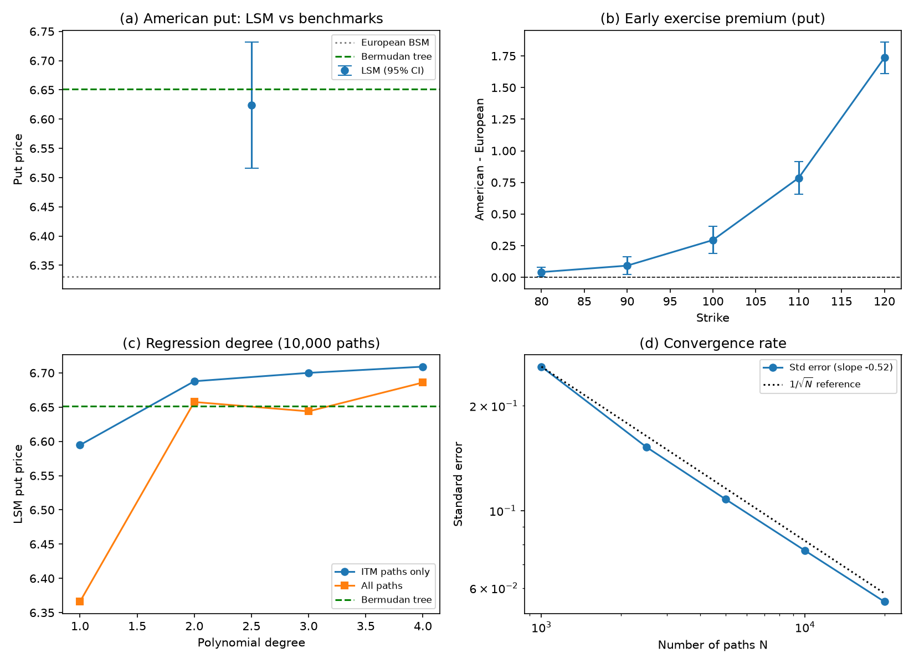
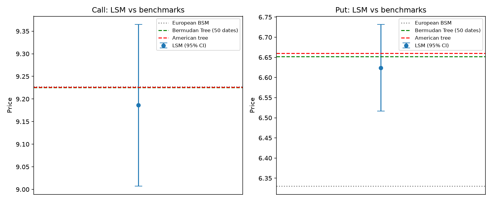
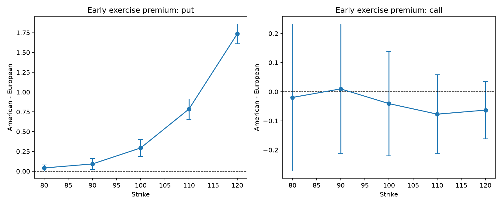
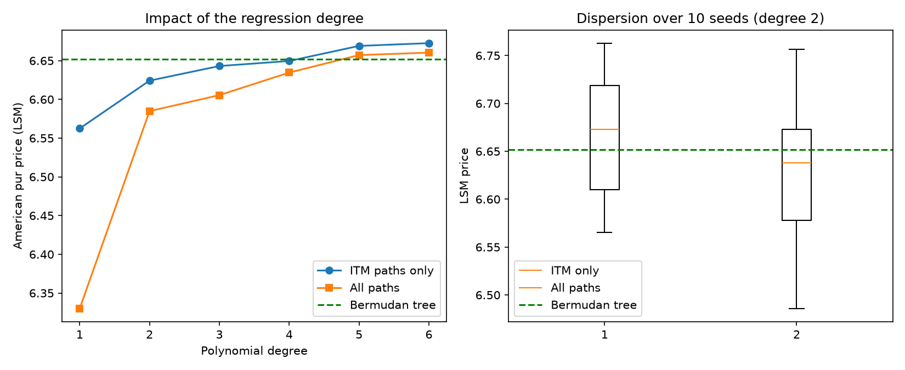
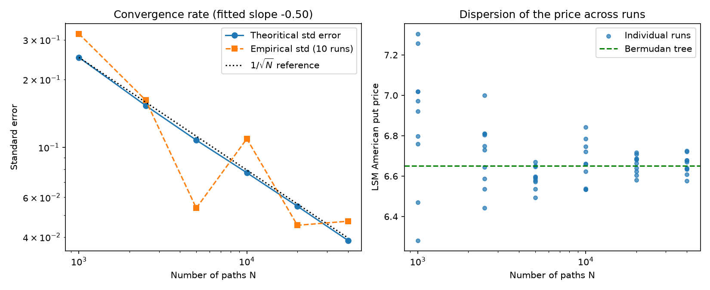

# American Option Pricer: Longstaff-Schwartz Monte Carlo

Monte Carlo pricer for American options (calls and puts) under Black-Scholes
dynamics with a continuous dividend yield, using the Longstaff-Schwartz
least-squares regression method (LSM).

Random numbers are generated **from scratch** (linear congruential generator +
Box-Muller), without `numpy.random`. Every result is validated against a
closed-form formula or a binomial tree.



## Model

Under the risk-neutral measure:

$$\frac{dS_t}{S_t} = (r - q)\,dt + \sigma\,dW_t$$

Paths are simulated with the exact log-normal scheme. The pricer uses `n_steps`
equally spaced exercise dates, so it prices a **Bermudan** option that
approaches the American one as `n_steps` grows.

## Features

- Custom RNG: LCG (Numerical Recipes parameters) + Box-Muller transform
- Exact GBM path simulation with dividend yield
- European benchmarks: Black-Scholes-Merton closed form and Monte Carlo
- Longstaff-Schwartz pricer for calls and puts, with:
  - configurable **degree of the regression polynomial**
  - choice between regressing on **all paths** or on **in-the-money paths only**
  - price, standard error and 95% confidence interval
- Cox-Ross-Rubinstein binomial tree (American and Bermudan) as a benchmark
- Studies: American vs European, regression settings, confidence interval vs number of paths
- Automated tests (`pytest`)

## Project structure

```
notebooks/   00_summary, 01_random_number_generation, 02_gbm_paths,
             03_european_option, 04_lsm_pricer, 05_american_vs_european,
             06_confidence_intervals
src/         rng.py, paths.py, european.py, lsm.py, binomial.py, analysis.py
tests/       test_pricer.py
figures/     plots used in this README
```

## Installation

Tested with Python 3.12.

```bash
pip install -r requirements.txt
pytest -v          # optional: run the test suite
```

## Usage

```python
from src.rng import LCG
from src.lsm import lsm_price

res = lsm_price(
    S0=100, K=100, r=0.05, q=0.02, sigma=0.20, T=1.0,
    n_steps=50,          # number of exercise dates
    n_paths=20_000,
    rng=LCG(seed=42),
    option="put",        # "call" or "put"
    degree=2,            # degree of the regression polynomial
    itm_only=True,       # True: regress on ITM paths only; False: all paths
)
print(res)   # {'price': ..., 'std_error': ..., 'ci_low': ..., 'ci_high': ...}
```

Parameters: S0 = 100, K = 100, r = 5%, q = 2%, σ = 20%, T = 1 year. The asset is
theoretical: this makes closed-form and tree benchmarks available, so the
pricer can be validated precisely.

## Results

### 1. Random number generator

On 10,000 Box-Muller normals (seed 42), the Kolmogorov-Smirnov test does not
reject normality (p = 0.068). Autocorrelations over 20 lags stay within the
95% band, and the GBM paths satisfy the discounted martingale property.

### 2. LSM vs binomial trees (ATM, 50 exercise dates, 20,000 paths)

| Option | European (BSM) | Bermudan tree (50 dates) | American tree | LSM (95% CI half-width) |
|---|---|---|---|---|
| Call | 9.2270 | 9.2251 | 9.2260 | 9.1861 ± 0.179 |
| Put  | 6.3301 | 6.6517 | 6.6602 | 6.6242 ± 0.108 |

The Bermudan tree lies inside the LSM confidence interval for both options.
Since r > q, early exercise of the call is never optimal, so American and
European call prices coincide.



### 3. Early exercise premium

For the put, the premium (American - European) grows with the strike:

| Strike | 80 | 90 | 100 | 110 | 120 |
|---|---|---|---|---|---|
| Premium | 0.041 | 0.092 | 0.294 | 0.785 | 1.735 |

For the call with r > q the premium is zero within noise (|premium| ≤ 1.3
standard errors). With q > r (r = 3%, q = 8%), it becomes significantly
positive: 1.44, 0.54 and 0.21 for K = 90, 100, 110.

For the ATM put, the absolute premium grows slowly with volatility
(0.30 to 0.38 for σ from 10% to 50%) while the relative premium falls
(11.5% to 2.2%). It also grows with maturity (0.085 at T = 0.25, 0.680 at T = 2).



### 4. Regression degree and path selection (ATM put, 20,000 paths, same seed)

| Degree | 1 | 2 | 3 | 4 | 5 | 6 |
|---|---|---|---|---|---|---|
| ITM paths only | 6.5624 | 6.6242 | 6.6431 | 6.6496 | 6.6691 | 6.6726 |
| All paths | 6.3299 | 6.5848 | 6.6055 | 6.6346 | 6.6572 | 6.6604 |

Bermudan tree reference: 6.6517.

- Degree 1 is insufficient. With all paths, it almost never exercises and
  returns the European price (6.3299 vs 6.3301).
- From degree 2 on, prices are close to the reference; differences at high
  degree are within Monte Carlo noise.
- Regressing on ITM paths only is better at low degree. Over 10 seeds
  (10,000 paths, degree 2), the dispersion is 0.069 (ITM) vs 0.083 (all paths).
  The mean biases (+0.013 and -0.021) are not statistically significant.



### 5. Confidence interval vs number of simulations

The standard error decreases as 1/√N: the fitted log-log slope is **-0.503**
(theory: -0.5), from 0.25 at N = 1,000 to 0.039 at N = 40,000.

The naive confidence interval is slightly too optimistic: the empirical
coverage is 91.7% over 60 runs, and 86% at N = 5,000 over 50 runs (nominal 95%).
At N = 5,000 the average reported standard error is 0.110 while the actual
dispersion of the price across runs is 0.136, i.e. about 19% higher.



## Limitations

- **Bermudan vs American**: 50 exercise dates approximate continuous exercise.
  The gap on the ATM put is about 0.0085 (6.6517 vs 6.6602 on the trees).
- **Naive confidence interval**: the exercise policy is estimated on the same
  paths that are priced. This correlates the cash flows, so the standard error
  understates the true uncertainty (see results above). The same effect biases
  the price upward at small N (6.88 on average at N = 1,000 vs about 6.66 from
  N = 10,000).
- **Speed**: the LCG is a pure Python loop, so path generation dominates the
  running time (a few seconds per 20,000 × 50 simulation).
- **RNG quality**: a 32-bit LCG (period 2^32) is fine for this project but
  not suited for production use.
- **Model**: constant volatility and rates, one underlying.

## Possible improvements

- Estimate the exercise policy on one set of paths and price on an independent
  set, to remove the overfitting bias and get a reliable confidence interval
- Variance reduction (antithetic variates, control variate with the European price)
- Vectorised or compiled generator (e.g. Numba) and quasi-random sequences (Sobol)
- Alternative regression bases (Laguerre polynomials)
- Stochastic volatility or discrete dividends